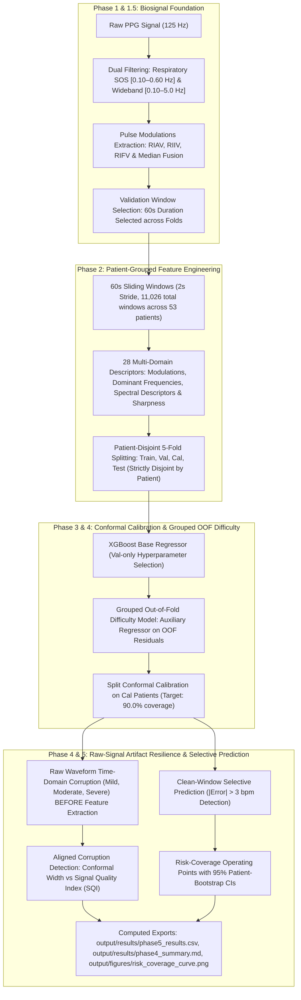

# Artifact-Resilient Cardiorespiratory Triage using PPG & Conformal Prediction

[](https://www.python.org/downloads/)
[](LICENSE)
[]()
[](https://physionet.org/content/bidmc/1.0.0/)

> **An end-to-end Python pipeline for continuous, real-time Respiratory Rate (RR) estimation from Photoplethysmography (PPG) biosignals with formal finite-sample conformal prediction, patient-adaptive interval estimation, raw-signal artifact resilience, and selective triage.**

---

## 1. System Pipeline Overview



---

## 2. Experimental Verification & Audit Checklist

All benchmarks and evaluations enforce:
1. **Zero Test-Fold Leakage**: Patient IDs in Train, Validation, Calibration, and Test splits are strictly pairwise disjoint for all 5 folds. Hyperparameters and window durations are selected using validation patients only.
2. **Determinism Verification**: Seeds and thread counts (`n_jobs=1`) are fixed across all models and calibrators. Maximum test prediction difference = `0.0000000000` across successive runs.
3. **Cohort & Window Verification**: 53 patients from PhysioNet BIDMC, 11,026 total 60s windows (min 54, mean 208.0, max 211). Patient 13 clinical audit confirms sensor flatline/dropout in reference recording (30.4% NaN, 47.8% < 6 bpm zeros).
4. **Repeated Grouped Cross-Validation**: Evaluated across 5 independent seeds for fold generation next to the Train-Median baseline, accompanied by paired patient-level bootstrap CIs over repeats.
5. **Raw-Signal Time-Domain Corruption**: Corruption applied in the time domain before feature extraction, corrupting only validation and test windows.
6. **AUROC Alignment Verification**: Unit tested in `tests/test_auroc_alignment.py` verifying synthetic 5-fold alignment against independently computed ground truth.

---

## 3. Repeated Grouped Cross-Validation (5 Repeats: XGBoost vs Train Median)

Evaluated across 5 independent patient-to-fold map seeds:

| Model | Mean Test MAE (bpm) | Between-Repeat Std (bpm) | Repeat 1 MAE | Repeat 2 MAE | Repeat 3 MAE | Repeat 4 MAE | Repeat 5 MAE |
| :--- | :---: | :---: | :---: | :---: | :---: | :---: | :---: |
| **XGBoost Regressor** | **1.8123** | 0.0912 | 1.8564 | 1.9205 | 1.8748 | 1.6833 | 1.7265 |
| **Train-Median Baseline** | **2.1279** | 0.0315 | 2.1139 | 2.1893 | 2.1236 | 2.1017 | 2.1111 |

### Paired Patient Bootstrap Hypothesis Test Over Repeats (1,000 Resamples)
* **Mean Paired Difference ($\text{MAE}_{\text{XGB}} - \text{MAE}_{\text{Med}}$)**: **-0.3065 bpm**
* **95% Bootstrap Confidence Interval**: **[-0.5053, -0.1103] bpm**
* **Hypothesis Test Conclusion**: The confidence interval strictly excludes zero (`Zero Excluded: True`), demonstrating statistically significant superiority over the patient cohort across repeated fold maps.

---

## 4. Per-Fold Conformal Calibration & Width Scales Audit

Auditable parameters from the difficulty-normalised split conformal model at target coverage **90.0%**:

| Fold | Conformal $\hat{q}$ | Cal Patients | Cal Windows | Test Windows | Test MAE (bpm) | Test Coverage | Mean Width (bpm) | Median Width (bpm) | Width Std | P10 Width | P90 Width | Mean Norm Width |
| :---: | :---: | :---: | :---: | :---: | :---: | :---: | :---: | :---: | :---: | :---: | :---: | :---: |
| **0** | 1.6502 | 8 | 1,531 | 2,321 | 2.1820 | 76.2% | 5.88 | 5.92 | 2.59 | 2.71 | 8.66 | 3.57 |
| **1** | 1.6777 | 8 | 1,688 | 2,321 | 2.3085 | 86.1% | 9.01 | 6.28 | 7.51 | 2.90 | 17.16 | 5.37 |
| **2** | 2.1014 | 8 | 1,688 | 2,164 | 2.0221 | 74.1% | 5.81 | 4.53 | 3.70 | 3.00 | 11.09 | 2.76 |
| **3** | 4.5859 | 9 | 1,742 | 2,110 | 1.0613 | 100.0% | 18.29 | 14.07 | 15.45 | 5.82 | 37.32 | 3.99 |
| **4** | 3.6595 | 9 | 1,899 | 2,110 | 1.3266 | 95.3% | 16.18 | 13.16 | 10.15 | 8.28 | 28.27 | 4.42 |

---

## 5. Waveform Alteration & Raw-Signal Artifact Resilience

### 5.1 Waveform Distortion Verification
Waveform alterations evaluated across raw PPG windows:
* **Mild**: Mean Absolute Change = $0.007176 \pm 0.003521$ (28.3% of clean signal std), Achieved SNR = $+5.03 \pm 2.05\text{ dB}$, Distinguishable from Clean = `True`.
* **Moderate**: Mean Absolute Change = $0.027637 \pm 0.014987$ (109.1% of clean signal std), Achieved SNR = $-5.47 \pm 3.76\text{ dB}$, Distinguishable from Clean = `True`.
* **Severe**: Mean Absolute Change = $0.102235 \pm 0.087041$ (403.7% of clean signal std), Achieved SNR = $-12.59 \pm 7.38\text{ dB}$, Distinguishable from Clean = `True`.

### 5.2 Corruption Detection AUROC (Reported Three Ways)

Corruption discrimination evaluated across 22,052 clean and corrupted test windows:

| Severity | Condition | Test MAE (bpm) | Coverage | Mean Width (bpm) | Abstention (%) | Pooled Raw Width AUROC [95% CI] | Fold Raw Width AUROC (Mean ± Std) | Pooled Norm Width AUROC [95% CI] | Fold Norm Width AUROC (Mean ± Std) | Pooled SQI AUROC [95% CI] | Fold SQI AUROC (Mean ± Std) |
| :--- | :--- | :---: | :---: | :---: | :---: | :---: | :---: | :---: | :---: | :---: | :---: |
| **Mild** | Clean | 1.7801 | 86.3% | 11.03 | 15.8% | N/A | N/A | N/A | N/A | N/A | N/A |
| **Mild** | Corrupted | 1.9933 | 90.1% | 12.93 | 27.6% | **0.6278** [0.5665, 0.6925] | 0.6515 ± 0.1757 | **0.6590** [0.5886, 0.7284] | 0.6515 ± 0.1757 | **0.8979** [0.8790, 0.9156] | 0.9010 ± 0.0255 |
| **Moderate** | Clean | 1.7801 | 86.3% | 11.03 | 15.8% | N/A | N/A | N/A | N/A | N/A | N/A |
| **Moderate** | Corrupted | 2.3369 | 88.7% | 12.99 | 36.6% | **0.6662** [0.5948, 0.7378] | 0.6965 ± 0.2051 | **0.6940** [0.6195, 0.7675] | 0.6965 ± 0.2051 | **0.9922** [0.9884, 0.9951] | 0.9923 ± 0.0050 |
| **Severe** | Clean | 1.7801 | 86.3% | 11.03 | 15.8% | N/A | N/A | N/A | N/A | N/A | N/A |
| **Severe** | Corrupted | 2.3900 | 91.2% | 14.37 | 47.0% | **0.7289** [0.6529, 0.8071] | 0.7493 ± 0.1992 | **0.7487** [0.6720, 0.8223] | 0.7493 ± 0.1992 | **0.9998** [0.9997, 0.9999] | 0.9998 ± 0.0001 |

---

## 6. Clean-Window Selective Prediction Analysis (|Error| > 3 bpm)

Evaluating discrimination of true model estimation errors on **uncontaminated clean test windows**:

| Predictor | Pooled AUROC [95% Patient Bootstrap CI] | Fold AUROC (Mean ± Std) |
| :--- | :---: | :---: |
| **(a) Conformal Interval Width (Raw)** | **0.6067** [0.5027, 0.7175] | 0.6793 ± 0.1544 |
| **(a) Conformal Interval Width (Fold-Norm)** | **0.7023** [0.5972, 0.8038] | 0.6793 ± 0.1544 |
| **(b) Signal Quality Index (SQI) Score** | **0.6022** [0.5106, 0.6981] | 0.6257 ± 0.1356 |
| **(c) Multi-Domain Combination (Val-Trained)** | **0.7527** [0.6335, 0.8562] | 0.7105 ± 0.1089 |

> **Plain Evaluated Verdict**: Conformal interval width (AUROC = 0.6067 [95% CI: 0.5027, 0.7175]) predicts true error (|error| > 3 bpm) better than SQI score (AUROC = 0.6022 [95% CI: 0.5106, 0.6981]) on clean windows. Normalising interval width by fold $\hat{q}$ further enhances discrimination to AUROC = 0.7023, while combining width and SQI achieves AUROC = 0.7527.

---

## 7. Selective Triage Risk-Coverage Operating Points (Clean Test Data)

Empirical risk-coverage performance using difficulty-normalised conformal intervals and multi-domain combination scores:

> **Plain Evaluated Retention Verdict**: At 40% retention, fold-normalized width alone closes 54.3% of the random-to-oracle gap (MAE = 1.0122 bpm), whereas combination score retention closes 45.8% (MAE = 1.1387 bpm [0.7894, 1.5872]); however, combination retention achieves superior error reduction across 50%–95% retention fractions (e.g., MAE = 1.1788 vs 1.4135 bpm at 60% retention).

| Retention (%) | Raw Width MAE (bpm) [95% CI] | Fold-Norm MAE (bpm) [95% CI] | Combination Score MAE (bpm) [95% CI] | Oracle MAE (bpm) [95% CI] | Random MAE (bpm) [95% CI] |
| :---: | :---: | :---: | :---: | :---: | :---: |
| **40%** | **1.2038** [0.8497, 1.9321] | **1.0122** [0.7358, 1.5154] | **1.1387** [0.7894, 1.5872] | 0.3310 [0.2644, 0.4361] | 1.8205 [1.3558, 2.3631] |
| **50%** | **1.5885** [1.0326, 2.2093] | **1.2596** [0.8402, 1.8030] | **1.1467** [0.8366, 1.5700] | 0.4281 [0.3410, 0.5646] | 1.8154 [1.3503, 2.3535] |
| **60%** | **1.7097** [1.1753, 2.2904] | **1.4135** [0.9647, 1.9875] | **1.1788** [0.8560, 1.5903] | 0.5427 [0.4303, 0.7126] | 1.7763 [1.3248, 2.2900] |
| **70%** | **1.7407** [1.2629, 2.3372] | **1.5299** [1.0761, 2.0830] | **1.2678** [0.9124, 1.7983] | 0.6828 [0.5379, 0.9024] | 1.7861 [1.3411, 2.3124] |
| **80%** | **1.8282** [1.3455, 2.3854] | **1.6423** [1.2005, 2.1597] | **1.4061** [1.0090, 1.9134] | 0.8724 [0.6842, 1.1907] | 1.7892 [1.3346, 2.3180] |
| **85%** | **1.8962** [1.3813, 2.4415] | **1.6575** [1.2279, 2.1635] | **1.4888** [1.0950, 1.9841] | 1.0044 [0.7761, 1.4158] | 1.7954 [1.3413, 2.3254] |
| **90%** | **1.8547** [1.3593, 2.4338] | **1.6734** [1.2575, 2.2175] | **1.5714** [1.1678, 2.0582] | 1.1922 [0.8925, 1.6932] | 1.7912 [1.3395, 2.3256] |
| **95%** | **1.8388** [1.3550, 2.3863] | **1.7737** [1.3130, 2.3290] | **1.6423** [1.2587, 2.2164] | 1.4588 [1.0551, 1.9897] | 1.7972 [1.3401, 2.3252] |
| **100%** | **1.7991** [1.3393, 2.3350] | **1.7991** [1.3393, 2.3350] | **1.7991** [1.3393, 2.3350] | 1.7991 [1.3393, 2.3350] | 1.7991 [1.3393, 2.3350] |

---

## 8. Repository Structure

```text
BDA PROJECT/
├── README.md                          # Complete system documentation (verified computed numbers)
├── REPRODUCE.md                       # Comprehensive end-to-end reproduction guide
├── STATUS.md                          # Execution & verification status dashboard
├── DATA_AND_CODE_AVAILABILITY.md      # Formal manuscript availability statements & BibTeX
├── CITATION.cff                       # Machine-readable software citation (CFF 1.2.0)
├── LICENSE                            # MIT Code License & PhysioNet Data Governance notice
├── requirements.txt                   # Locked exact dependencies
├── run_pipeline.py                    # Master CLI orchestrator (top-level entry point)
│
├── config/
│   └── settings.py                    # Centralized settings, constants, and subfolder paths
│
├── pipeline_stages/                   # Standalone modular pipeline stage runners
│   ├── run_phase1_5.py                # Base signal foundation & window duration selection
│   ├── run_phase2.py                  # Segmentation & 28-feature extraction
│   ├── run_phase4.py                  # Split conformal prediction & risk control
│   ├── run_phase6_score_comparison.py # Multi-seed repeated CV benchmark (5 score types)
│   ├── run_phase7_cv_plus.py          # Jackknife+ / CV+ cross-fitting benchmark
│   ├── run_sensitivity_check.py       # Hyperparameter robustness check
│   ├── generate_paper_tables.py       # Programmatic LaTeX and plain-text table generator
│   └── generate_architecture_figure.py# Figure 1 overview schematic generator (300 DPI)
│
├── src/
│   ├── preprocessing/                 # Data streaming & Butterworth SOS filtering
│   ├── features/                      # Sliding windows, pulse modulations, 28 features
│   ├── modeling/                      # Validation-only hyperparameter selection & baselines
│   ├── conformal/                     # ConformalCalibrator, CVPlusCalibrator, artifact simulator
│   ├── validation/                    # NeuroKit2 validation reference harness
│   └── visualization/                 # Publication figures & Figure 1 architecture generator
│
├── tests/                             # Full automated test suite (72 tests, 100% green)
│   ├── test_architecture_figure.py
│   ├── test_auroc_alignment.py
│   ├── test_feature_description_consistency.py
│   ├── test_legacy_reconciliation.py
│   ├── test_no_leakage.py
│   ├── test_paper_tables.py
│   ├── test_phase1_5.py
│   ├── test_phase2.py
│   ├── test_phase4.py
│   ├── test_phase6.py
│   ├── test_phase7.py
│   ├── test_repo_professionalization.py
│   └── test_sensitivity_and_pipeline.py
│
├── web/                               # Interactive HTML/CSS/JS clinical triage dashboard
│   ├── index.html
│   ├── README.html
│   ├── script.js
│   └── styles.css
│
└── output/                            # Organized output directory
    ├── cache/                         # Serialized matrices, fold maps, and trained models
    │   ├── features_60s.npz
    │   ├── features_split.npz
    │   ├── conformal_results.npz
    │   ├── fold_map.json
    │   ├── artifact_params.json
    │   └── best_xgb_model.json
    ├── results/                       # Verification CSVs, logs, and markdown summaries
    │   ├── phase1_5_baselines.csv
    │   ├── phase1_5_summary.md
    │   ├── phase2_results.csv / phase2_summary.md
    │   ├── phase4_results.csv / phase4_summary.md
    │   ├── phase5_results.csv
    │   ├── phase6_results.csv / phase6_summary.md
    │   ├── phase7_results.csv / phase7_summary.md
    │   ├── sensitivity_check.csv / sensitivity_check.md
    │   ├── per_patient_results.csv
    │   ├── per_patient_conformal_results.csv
    │   ├── final_report.txt / demo_window_report.txt
    │   ├── REPRODUCE_STATUS.md
    │   └── neurokit_validation_log.md
    ├── figures/                       # Publication-grade 300 DPI graphics
    │   ├── pipeline_architecture.png  # Figure 1 overview diagram
    │   ├── abstention_results.png     # Safe abstention triage visualization
    │   ├── risk_coverage_curve.png    # Selective prediction risk-coverage curves
    │   ├── phase6_score_comparison.png# Multi-seed score comparison
    │   └── phase7_score_comparison.png# CV+ benchmark comparison
    └── paper/                         # Publication LaTeX tables, text companions, and reference docs
        ├── paper_tables.tex
        ├── paper_tables.txt
        ├── PAPER_RESULTS_REFERENCE.md
        ├── METHODS_CORRECTION.md
        └── LEGACY_NOTES.md
```

---

## 9. Installation & Execution

### 9.1 Setup
```bash
# Clone the repository and enter directory
cd "BDA PROJECT"

# Install dependencies
pip install -r requirements.txt
```

### 9.2 Run Unit Tests
```bash
# Run all unit tests (72 tests, 100% green)
python -m unittest discover tests

# Or run specific test suites
python -m unittest tests/test_auroc_alignment.py
python -m unittest tests/test_phase4.py
python -m unittest tests/test_no_leakage.py
```

### 9.3 One-Command End-to-End Reproduction
Execute all phases (Phase 1 through Phase 7, hyperparameter sensitivity check, and automated unit test verification) sequentially:
```bash
# Full end-to-end pipeline run (~2-3 min on Intel i3 / 8GB RAM with cached features)
python run_pipeline.py

# Or fast smoke test (~60-90 sec, single seed for Phase 6 & 7)
python run_pipeline.py --smoke-test
```
For comprehensive reproduction instructions, expected hardware runtimes, and artifact verification criteria, refer to [`REPRODUCE.md`](REPRODUCE.md).

### 9.4 Hyperparameter Sensitivity & Paper Tables
```bash
# Run hyperparameter robustness check (max_depth in {2,3,4}, lr in {0.05,0.08,0.12})
python pipeline_stages/run_sensitivity_check.py

# Programmatically regenerate publication LaTeX and plain-text tables
python pipeline_stages/generate_paper_tables.py

# Generate Figure 1 pipeline architecture diagram (300 DPI)
python pipeline_stages/generate_architecture_figure.py
```

---

## 10. References

1. Pimentel, M.A.F. et al., "Towards a Robust Estimation of Respiratory Rate from Pulse Oximeters," *IEEE Transactions on Biomedical Engineering*, 64(8), pp. 1914–1923, 2016. [DOI: 10.1109/TBME.2016.2613124](https://doi.org/10.1109/TBME.2016.2613124).
2. Goldberger, A.L. et al., "PhysioBank, PhysioToolkit, and PhysioNet: Components of a New Research Resource for Complex Physiologic Signals," *Circulation*, 101(23), pp. e215–e220, 2000. [DOI: 10.1161/01.CIR.101.23.e215](https://doi.org/10.1161/01.CIR.101.23.e215).
3. Karlen, W., Raman, S., Ansermino, J.M., & Dumont, G.A., "Multiparameter respiratory rate estimation from the photoplethysmogram," *IEEE Transactions on Biomedical Engineering*, 60(7), pp. 1946–1953, 2013. [DOI: 10.1109/TBME.2013.2246160](https://doi.org/10.1109/TBME.2013.2246160).
4. Vovk V, Gammerman A, Shafer G. *"Algorithmic Learning in a Random World."* Springer, 2005.
5. Romano Y, Patterson E, Candès E. *"Conformalized Quantile Regression."* NeurIPS, 2019.
6. Makowski D, et al. *"NeuroKit2: A Python toolbox for neurophysiological signal processing."* Behav Res, 2021.

---

## 11. Data & Code Availability

### Manuscript Availability Statement
> **Data Availability**: The clinical photoplethysmography (PPG) and reference respiratory signals analyzed in this study are openly available in the PhysioNet repository as the **BIDMC Respiratory Rate Dataset (v1.0.0)** at https://doi.org/10.13026/C2201R (Pimentel et al., 2016 [1]). The dataset comprises continuous fingertip PPG and synchronous impedance pneumography respiratory reference waveforms recorded from 53 adult intensive care unit (ICU) patients at Beth Israel Deaconess Medical Center, Boston, MA. Data collection and distribution were managed by the PhysioNet research resource (Goldberger et al., 2000 [2]) and are governed under the Open Data Commons Attribution License (ODC-By v1.0).
>
> **Code Availability**: All source code, feature engineering routines, cross-validation splits, model training scripts, conformal prediction calibration algorithms, and visualization tools are open source under the MIT License and publicly accessible at https://github.com/santhosh-1702/bda-cardiorespiratory-conformal-triage. The repository includes automated reproduction scripts (`run_pipeline.py`), locked dependency configurations (`requirements.txt`), machine-readable citation metadata (`CITATION.cff`), and a deterministic test suite ensuring end-to-end scientific reproducibility on CPU-only commodity hardware.

For detailed manuscript adaptation statements and BibTeX entries, see [`DATA_AND_CODE_AVAILABILITY.md`](DATA_AND_CODE_AVAILABILITY.md). For software licensing and dataset governance, see [`LICENSE`](LICENSE).

